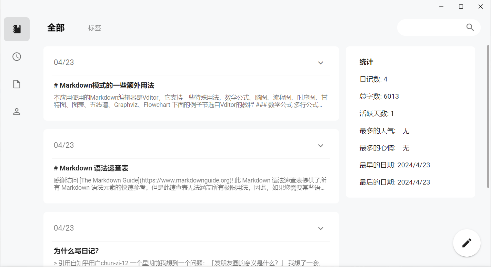
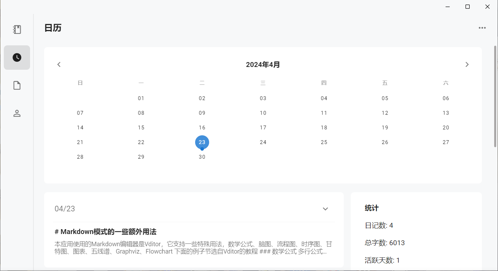
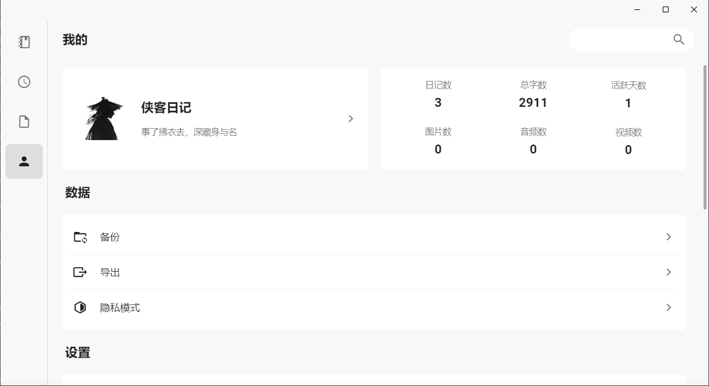
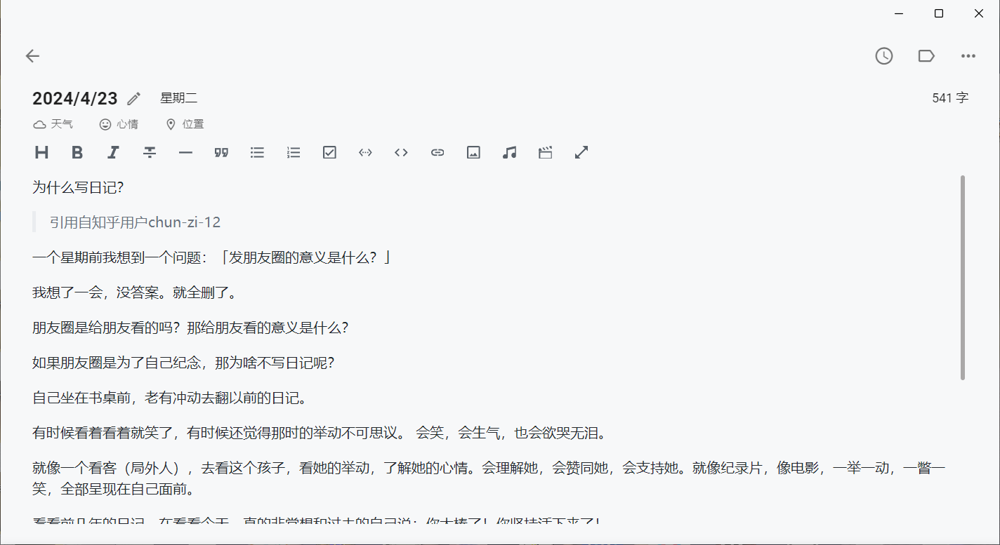
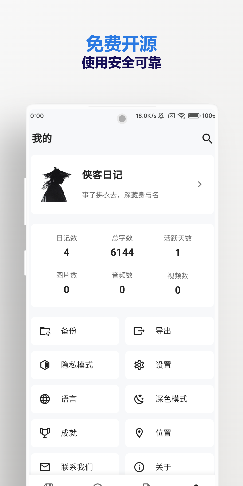

<h1 align="center">Swashbuckler Diary - Brain Training Manual Edition</h1>

English | [简体中文](./README.md)

"Swashbuckler Diary" is an open source, cross platform local diary application.

"Swashbuckler Diary - Brain Training Manual Edition" is a modified version of "Swashbuckler Diary" based on <Source: open your mind, change your life> by Tara Swart.
I think that although keeping a diary is a great habit, we never really clarify why we keep one or what a diary should focus on. After reading <Source: open your mind, change your life>, I modified the open source diary app "Swashbuckler Diary", building every note the way the book describes.
(If you haven't read the book, I strongly recommend it. The title is plain, but it is very inspiring.)

## 🔗 Online preview
[Swashbuckler Diary Live Demo（GitHub Pages）](https://yu-core.github.io/SwashbucklerDiary/)
[Swashbuckler Diary - Brain Training Manual Edition Live Demo（GitHub Pages）](404)

## 🛠️ Main Technology Stack
- [Blazor Hybrid](https://github.com/Yu-Core/SwashbucklerDiary)
- [Claude Code](https://claude.com)
- [DeepSeek](https://deepseek.com)

## 🚀 Download Channels
- This repository

## ⬇️ [Download Guide](./doc/download-guide.md)
See details [./download-guide.md](./download-guide.md) 

## ✨ Characteristics
* Minimalist UI design
* Markdown real-time rendering
* Cross platform (Android, Windows, macOS, Web, Linux)
* Multi size responsive interface layout
* All data is stored locally without the need for networking
* Privacy mode, guarding your secret diary
* Supports images, audio, and video
* Supports mathematical formulas, brain maps, charts, flowcharts, Gantt c harts, time series diagrams, and staff charts
* Supports multiple languages
* Supports dark mode
* Label classification display
* Weather, mood, location
* Export multiple format files
* Support text and image sharing
* Support webdav backup
* WebDAV multi-device sync (diaries, reviews, locations; media optional)
* Synchronous transmission under the same local area network

## 🧩 Screenshot
<table>
    <tr>
        <td></td>
        <td></td>
    </tr>
    <tr>
        <td></td>
        <td></td>
    </tr>
 </table>

 <table>
    <tr>
        <td></td>
        <td></td>
        <td></td>
        <td></td>
    </tr>
 </table>

## 🖥 Supported Platforms
- Windows (Windows 11 and Windows 10 version 1809 or higher)
- Android (Android 8.0 (API 26) or higher)

## 🌏️ Supported Languages
| Code  | Language               | View                                                             |
| ----- | ---------------------- | ---------------------------------------------------------------- |
| en-US | English (United States)| [View](./src/SwashbucklerDiary.Rcl/wwwroot/i18n/en-US.json)      |
| zh-CN | Chinese (Simplified)   | [View](./src/SwashbucklerDiary.Rcl/wwwroot/i18n/zh-CN.json)      |

## ⌨️ Development Environment
[Visual Studio 2026](https://learn.microsoft.com/visualstudio/install/install-visual-studio?view=visualstudio)

- System requirements

    - Windows 10 version 1909 or higher: Home, Professional, Education, and Enterprise

- Workload

    - Web and Cloud
        - ASP.NET and Web Development
    - Desktop and mobile apps
        - Mobile development using .NET / .NET Multi platform App UI development
        - .NET Desktop Development

[Visual Studio Code](https://code.visualstudio.com/docs)

- Basic environment
 
    - [.Net 10 SDK](https://dotnet.microsoft.com/download/dotnet/10.0)
    - [libwebkitgtk-6.0-4(Optional)](https://packages.ubuntu.com/jammy/libwebkitgtk-6.0-4) (For develop Linux)
    - [OpenJDK 17(Optional)](https://learn.microsoft.com/zh-cn/java/openjdk/download#openjdk-17) (For develop Android)
    - [Xcode(Optional)](https://developer.apple.com/xcode) (For develop macOS)

- Extension

    - [C# Dev Kit](https://marketplace.visualstudio.com/items?itemName=ms-dotnettools.csdevkit)
    - [.NET MAUI](https://marketplace.visualstudio.com/items?itemName=ms-dotnettools.dotnet-maui)

## 🏗️ [Project structure](./directory-structure.md)
See details [./directory-structure.md](./directory-structure.md)  

## 🙏 Thanks to the following Open Source Projects
- [SwashbucklerDiary](https://github.com/Yu-Core/SwashbucklerDiary)

## ☕Sponsor
The development of the project cannot do without your support. Please have a cup of coffee with the author of "Swashbuckler Diary"☕

