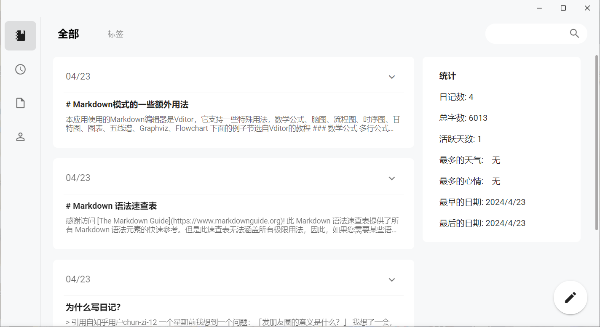
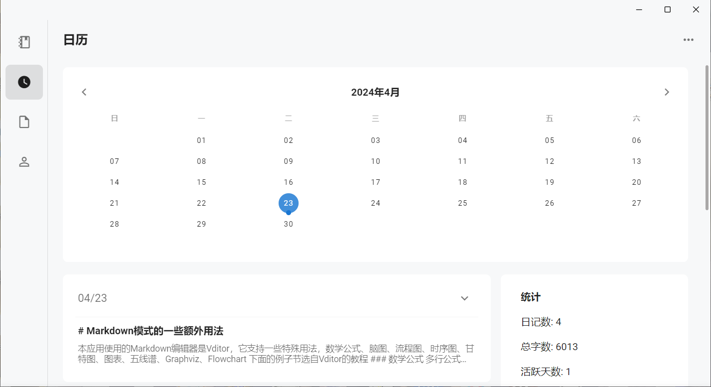
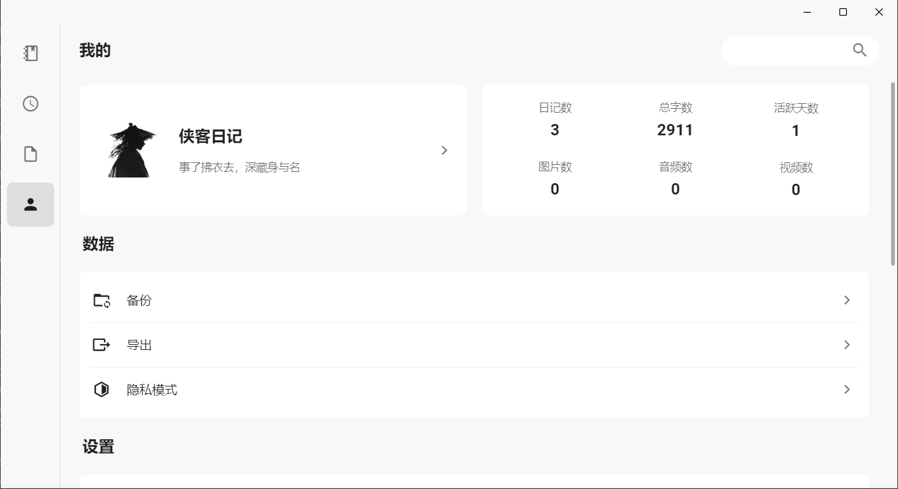
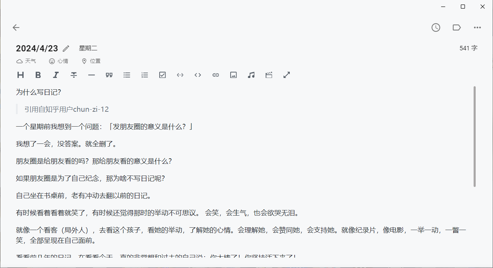
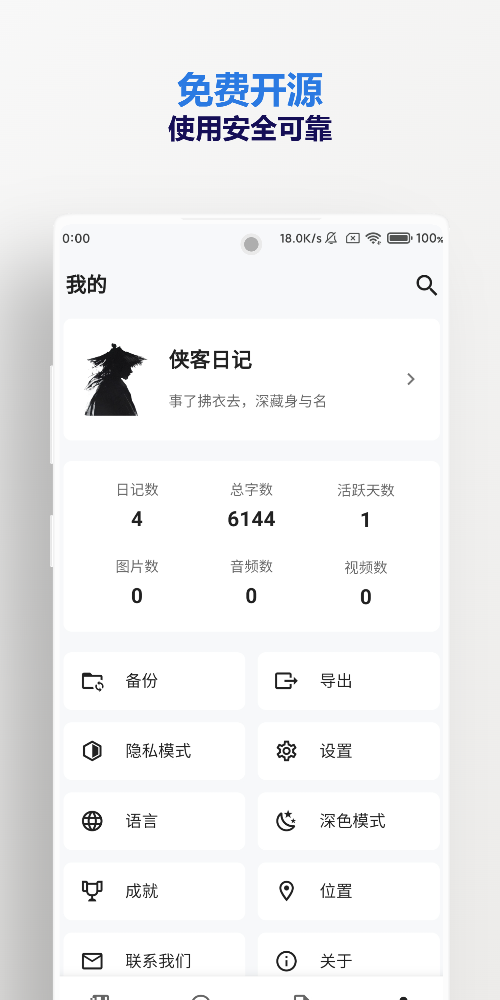
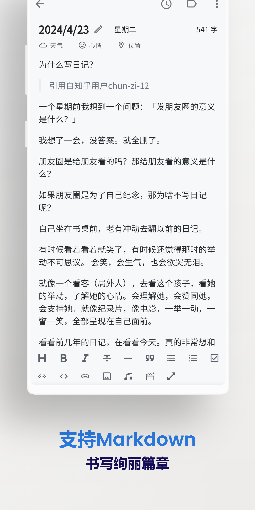

<h1 align="center">侠客日记_大脑训练手册适配版</h1>

[English](./README.en-US.md) | 简体中文

「 侠客日记 」是一个开源、跨平台的本地日记APP。

「 侠客日记_大脑训练手册适配版 」是从「 侠客日记 」上按照塔拉·斯瓦特的<大脑训练手册>改造后的版本。
我认为虽然记日记是一个很好的习惯, 但是我们没有明确为什么要记日记, 日记需要关注哪些点, 学习了<大脑训练手册后>我将开源日记本「 侠客日记 」进行了改造, 一切按照书中的方式去制作笔记.
(没有看过这本书的, 强烈推荐去阅读一下, 虽然名字很糙, 但是给人启发很大)

## 🔗 在线预览
[侠客日记 在线演示地址（GitHub Pages）](https://yu-core.github.io/SwashbucklerDiary/)
[侠客日记_大脑训练手册版 在线演示地址（GitHub Pages）](404)

## 🛠️ 主要技术栈
- [Blazor Hybrid](https://github.com/Yu-Core/SwashbucklerDiary)
- [Claude Code](https://claude.com)
- [DeepSeek](https://deepseek.com)

## 🚀 下载渠道
- 这个仓库

## ⬇️ [下载指南](./doc/download-guide.md)
详见 [./download-guide.md](./download-guide.md) 

## ✨ 特点
* 极简风格的UI设计
* Markdown即时渲染
* 跨平台（Android，Windows，macOS，Web，Linux）
* 多尺寸响应式的界面布局
* 所有数据存储本地，无需联网
* 隐私模式，守护你的秘密日记
* 支持图片、音频、视频
* 支持数学公式、脑图、图表、流程图、甘特图、时序图、五线谱
* 支持多种语言
* 支持深色模式
* 标签分类展示
* 天气、心情、位置
* 导出多种格式文件
* 支持文字、图片分享
* 支持webdav备份
* 支持 WebDAV 多端同步（日记、复盘、地点，附件可选）
* 同一局域网下同步传输

## 🧩 截图
<table>
    <tr>
        <td></td>
        <td></td>
    </tr>
    <tr>
        <td></td>
        <td></td>
    </tr>
 </table>

 <table>
    <tr>
        <td></td>
        <td></td>
        <td></td>
        <td></td>
    </tr>
 </table>

## 🖥 支持的平台
- Windows (Windows 11和Windows 10版本 1809 或更高版本)
- Android (Android 8.0 (API 26) 或更高版本)

## 🌏️ 支持的语言
| 代码    | 语言             | 查看                                                             |
| ------- | ---------------- | ---------------------------------------------------------------- |
| en-US   | 英语（美国）       | [查看](./src/SwashbucklerDiary.Rcl/wwwroot/i18n/en-US.json)      |
| zh-CN   | 中文（简体）       | [查看](./src/SwashbucklerDiary.Rcl/wwwroot/i18n/zh-CN.json)      |

## ⌨️ 开发环境
[Visual Studio 2026](https://learn.microsoft.com/visualstudio/install/install-visual-studio?view=visualstudio)

- 系统要求

    - Windows 10 版本 1909 或更高版本：家庭版、专业版、教育版和企业版。

- 工作负荷

    - Web 和云
        - ASP.NET 和 Web 开发
    - 桌面应用和移动应用
        - 使用 .NET 的移动开发 / .NET Multi-platform App UI 开发
        - .NET 桌面开发
     
[Visual Studio Code](https://code.visualstudio.com/docs)

- 基础环境
 
    - [.Net 10 SDK](https://dotnet.microsoft.com/download/dotnet/10.0)
    - [libwebkitgtk-6.0-4（可选）](https://packages.ubuntu.com/jammy/libwebkitgtk-6.0-4) (For develop Linux)
    - [OpenJDK 17（可选）](https://learn.microsoft.com/zh-cn/java/openjdk/download#openjdk-17) (For develop Android)
    - [Xcode（可选）](https://developer.apple.com/xcode) (For develop macOS)

- 扩展

    - [C# Dev Kit](https://marketplace.visualstudio.com/items?itemName=ms-dotnettools.csdevkit)
    - [.NET MAUI](https://marketplace.visualstudio.com/items?itemName=ms-dotnettools.dotnet-maui)

## 🏗️ [项目结构](./directory-structure.md)
详见 [./directory-structure.md](./directory-structure.md)  

## 🙏 感谢以下开源项目
- [SwashbucklerDiary](https://github.com/Yu-Core/SwashbucklerDiary)

## ☕捐助
项目的发展离不开你的支持，请「 侠客日记 」作者喝杯咖啡吧☕

